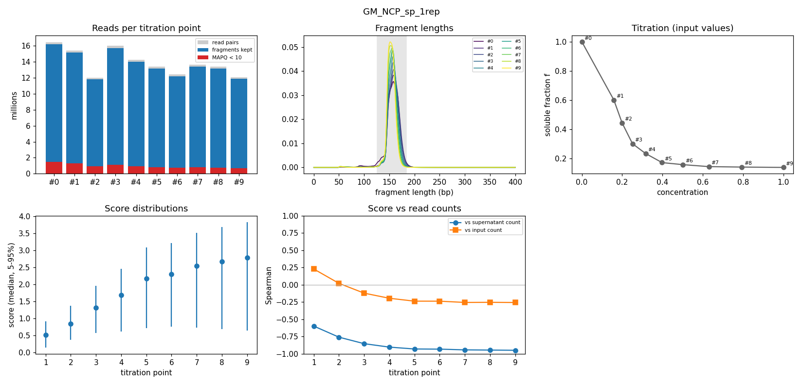
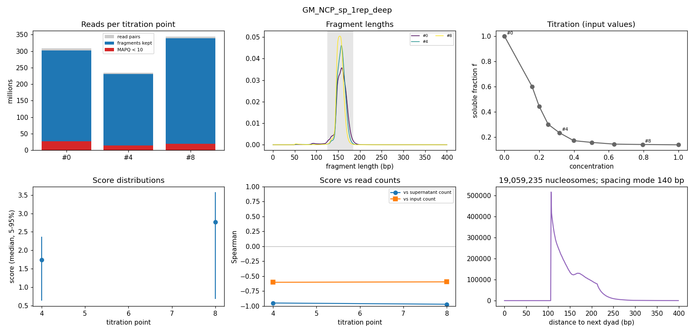
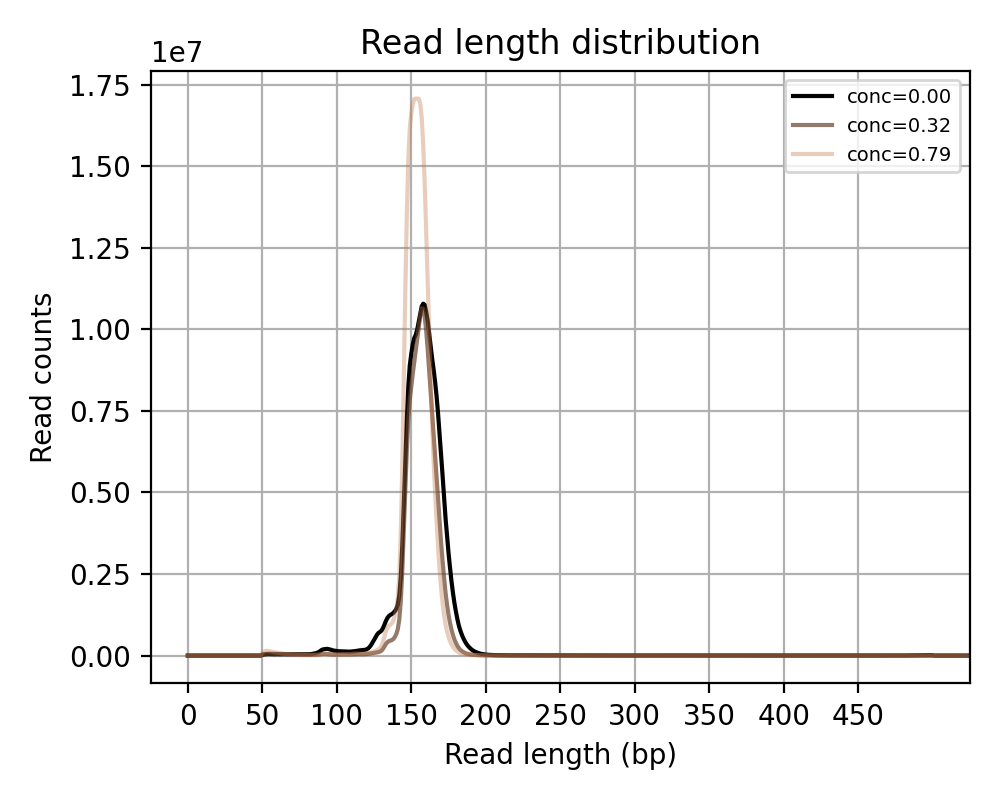
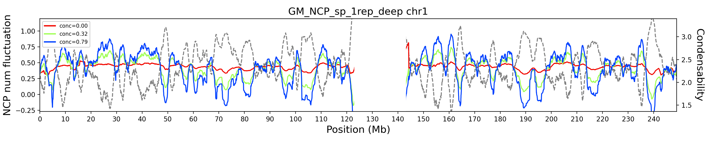
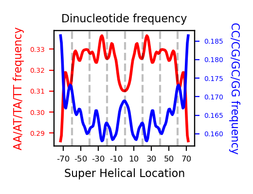
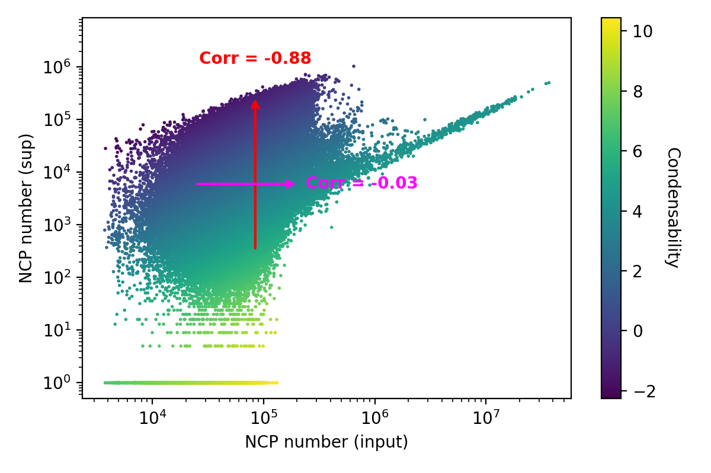
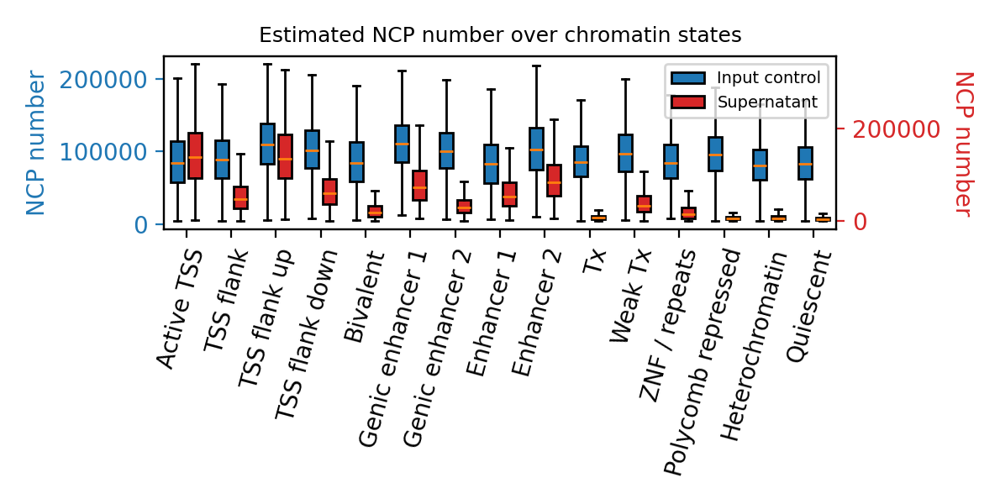
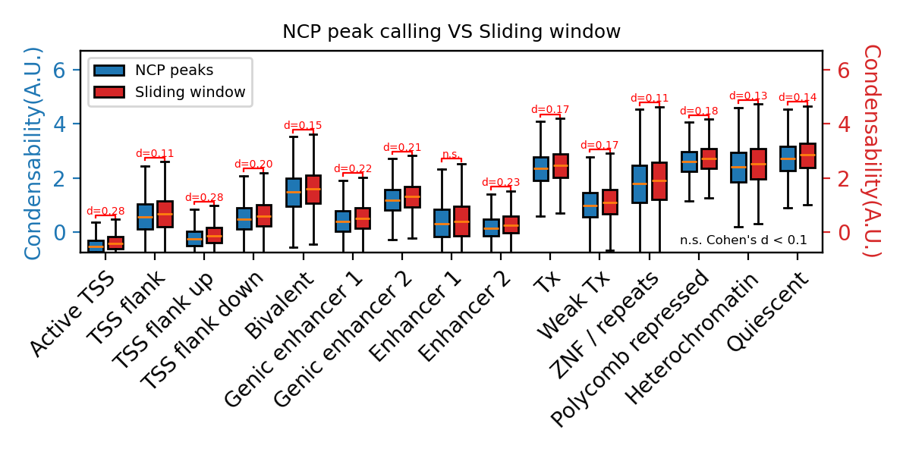
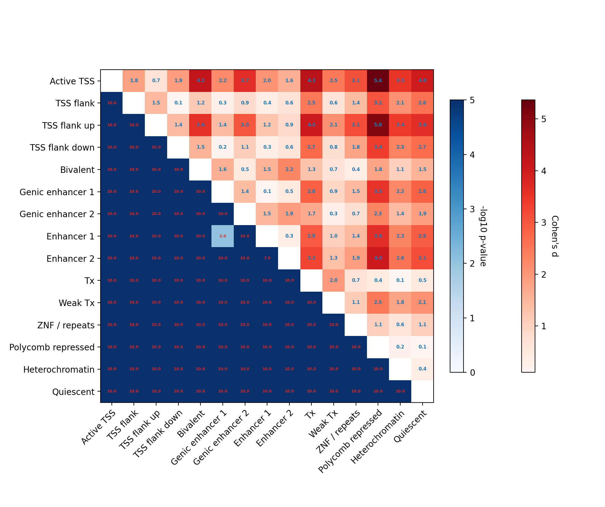

# Example QC report

What `results/qc/report.html` looks like, from two runs of the paper's GM12878 data (Park, Merino-Urteaga, Karwacki-Neisius, Carrizo, Athreya … Ha, Nature, 2025; GEO GSE252941,
replicate 1), whose score tables are identical to GEO's. The report itself is an HTML page with the same tables
and figures; flags are also in `qc/flags.tsv`.

## Shallow series: `GM_NCP_sp_1rep`

The input and 9 spermine concentrations, 12–16 M read pairs each, scored in 10 kb bins. No flags.

Samples, one row per library:

| sample | read_pairs | alignment_rate | fragments | used_fraction | lowmapq_fraction | tlen_mode | tlen_median | mono_fraction | subnucleosomal_fraction |
|---|---|---|---|---|---|---|---|---|---|
| GM_NCP_sp_0_1rep | 16,470,170 | 0.991 | 16,192,740 | 0.983 | 0.0896 | 158 | 158 | 0.958 | 0.0232 |
| GM_NCP_sp_1_1rep | 15,393,834 | 0.992 | 15,170,549 | 0.985 | 0.0846 | 159 | 159 | 0.973 | 0.0137 |
| GM_NCP_sp_2_1rep | 12,012,489 | 0.993 | 11,855,624 | 0.987 | 0.0774 | 159 | 159 | 0.977 | 0.0124 |
| GM_NCP_sp_3_1rep | 16,034,135 | 0.991 | 15,746,658 | 0.982 | 0.0699 | 158 | 158 | 0.979 | 0.0132 |
| GM_NCP_sp_4_1rep | 14,288,748 | 0.991 | 14,048,502 | 0.983 | 0.065 | 157 | 157 | 0.982 | 0.0124 |
| GM_NCP_sp_5_1rep | 13,393,452 | 0.99 | 13,156,950 | 0.982 | 0.0609 | 157 | 156 | 0.985 | 0.0106 |
| GM_NCP_sp_6_1rep | 12,451,496 | 0.989 | 12,188,431 | 0.979 | 0.0604 | 157 | 156 | 0.985 | 0.0106 |
| GM_NCP_sp_7_1rep | 13,678,995 | 0.989 | 13,422,881 | 0.981 | 0.0584 | 156 | 155 | 0.986 | 0.0106 |
| GM_NCP_sp_8_1rep | 13,425,177 | 0.989 | 13,188,170 | 0.982 | 0.0577 | 152 | 154 | 0.985 | 0.0109 |
| GM_NCP_sp_9_1rep | 12,090,857 | 0.99 | 11,895,313 | 0.984 | 0.0565 | 152 | 154 | 0.989 | 0.0072 |

Titration points:

| series | zero_input_fraction | input_cv | point | tnum | bins_scored | score_median | rho_input | rho_supernatant |
|---|---|---|---|---|---|---|---|---|
| GM_NCP_sp_1rep | 0.039 | 0.66 | GM_NCP_sp_1_1rep | 1 | 291,290 | 0.516 | 0.229 | -0.598 |
| GM_NCP_sp_1rep | 0.039 | 0.66 | GM_NCP_sp_2_1rep | 2 | 291,290 | 0.845 | 0.0209 | -0.759 |
| GM_NCP_sp_1rep | 0.039 | 0.66 | GM_NCP_sp_3_1rep | 3 | 291,290 | 1.31 | -0.121 | -0.853 |
| GM_NCP_sp_1rep | 0.039 | 0.66 | GM_NCP_sp_4_1rep | 4 | 291,290 | 1.69 | -0.195 | -0.903 |
| GM_NCP_sp_1rep | 0.039 | 0.66 | GM_NCP_sp_5_1rep | 5 | 291,290 | 2.17 | -0.237 | -0.93 |
| GM_NCP_sp_1rep | 0.039 | 0.66 | GM_NCP_sp_6_1rep | 6 | 291,290 | 2.3 | -0.238 | -0.932 |
| GM_NCP_sp_1rep | 0.039 | 0.66 | GM_NCP_sp_7_1rep | 7 | 291,290 | 2.53 | -0.256 | -0.943 |
| GM_NCP_sp_1rep | 0.039 | 0.66 | GM_NCP_sp_8_1rep | 8 | 291,290 | 2.67 | -0.254 | -0.945 |
| GM_NCP_sp_1rep | 0.039 | 0.66 | GM_NCP_sp_9_1rep | 9 | 291,290 | 2.78 | -0.256 | -0.949 |

## Deep series: `GM_NCP_sp_1rep_deep`

The input and two concentrations, 235–344 M read pairs each, scored in 1 kb bins and per nucleosome. The last
panel is the distance from each called nucleosome to the next; none are called closer than ~107 bp, since called
nucleosomes may overlap by at most 40 bp.

Two flags: at both points the score correlates with the input read count (Spearman ρ ≈ −0.6, threshold 0.3).
The tables are GEO's, so this is in the paper's data, not added by the processing.

| level | name | metric | value | threshold |
|---|---|---|---|---|
| warn | GM_NCP_sp_4_1rep_deep | rho_input | -0.602 | max_score_input_rho = 0.3 |
| warn | GM_NCP_sp_8_1rep_deep | rho_input | -0.595 | max_score_input_rho = 0.3 |

Samples:

| sample | read_pairs | alignment_rate | fragments | used_fraction | lowmapq_fraction | tlen_mode | tlen_median | mono_fraction | subnucleosomal_fraction |
|---|---|---|---|---|---|---|---|---|---|
| GM_NCP_sp_0_1rep_deep | 309,020,734 | 0.988 | 302,487,334 | 0.979 | 0.0899 | 158 | 158 | 0.959 | 0.0215 |
| GM_NCP_sp_4_1rep_deep | 234,939,018 | 0.993 | 231,267,236 | 0.984 | 0.0648 | 157 | 157 | 0.983 | 0.0118 |
| GM_NCP_sp_8_1rep_deep | 344,389,101 | 0.991 | 339,083,630 | 0.985 | 0.0574 | 153 | 154 | 0.986 | 0.0105 |

Titration points:

| series | zero_input_fraction | input_cv | nucleosomes | spacing_mode | point | tnum | bins_scored | score_median | rho_input | rho_supernatant |
|---|---|---|---|---|---|---|---|---|---|---|
| GM_NCP_sp_1rep_deep | 0.0389 | 0.631 | 19,059,235 | 140 | GM_NCP_sp_4_1rep_deep | 4 | 291,328 | 1.74 | -0.602 | -0.949 |
| GM_NCP_sp_1rep_deep | 0.0389 | 0.631 | 19,059,235 | 140 | GM_NCP_sp_8_1rep_deep | 8 | 291,328 | 2.77 | -0.595 | -0.97 |

## Panels after Extended Data Fig. 2

The same deep series, run with `--states auto` (ENCODE's ChromHMM 15-state model of GM12878, ENCFF140VIG). The
QC step redraws the panels of the paper's Extended Data Fig. 2 that one dataset allows, on chromosome 1, with the
computations and styling of the paper's notebooks ([details](details.md#qc-panels-after-extended-data-fig-2)). The
paper shows them for H1; a shallow series gets panels c and d only.

**c** Fragment lengths: modes 158, 157 and 153 bp; 96–99% of fragments are 126–184 bp.

**d** NCP number along chromosome 1 (25 kb bins, smoothed, log10, centred) for each sample, and the condensability
of the last point (dashed, right axis). The centromere and the 1q12 heterochromatin (acen and gvar bands) are masked.
The input is nearly flat; the supernatant at 0.79 mM falls where condensability rises.

**e** Dinucleotides across 147 bp at 1.51 M dyads called on chromosome 1: AA/AT/TA/TT and CC/CG/GC/GG alternate with
a period of 10.3 bp.

**f** Per nucleosome, input vs supernatant NCP number, coloured by condensability. Condensability follows the
supernatant (Spearman −0.88) and not the input (−0.03); the paper's H1 values are −0.79 and 0.14.

**g** NCP number per chromatin state: the input is similar across states, while the supernatant is lowest in
transcribed, Polycomb, heterochromatin and quiescent states.

**h** Condensability per state from the called nucleosomes and from 9.2 M sliding windows (171 bp, every 25 bp).
The two agree to Cohen's d 0.09–0.28 per state; the paper's H1 panel marks the states n.s. (d < 0.1).

**i** Cohen's d (upper triangle) and −log10 Welch p-value (lower, capped at 10) between the states' condensability.

## What each part means

- **Flags**: values outside the expected range, `warn` or `info`. Thresholds, and how to change them
  (`qc_thresholds:` in the settings), are at the end of every report.
- **Samples**: read pairs, bowtie2 alignment rate, fragments kept, the share of multi-mapping fragments
  (MAPQ < 10), fragment-length mode and median, mononucleosome (126–184 bp) and shorter fragments.
- **Titration points**: bins without input reads, bins scored, median score, and the Spearman correlation of the
  score with the input and the supernatant counts (deep series: nucleosomes called and the commonest spacing).
- **Figures**, per series: reads per point, fragment lengths, the titration, score distributions, score vs read
  counts; c½ fits where a series is fitted; nucleosome spacing for deep series. `--qc verbose` adds duplicates,
  GC dependence, a chromosome profile and dinucleotide periodicity.
- **Replicates** (when a run has several): Spearman between replicates at each point, with scatter plots.
- **Panels after Extended Data Fig. 2**, per series: c and d for every series, e and f for deep series, g–i for
  deep series with chromatin states (`--states`), with a summary table (dinucleotide period, the two Spearman
  values of f, the largest Cohen's d of h).
