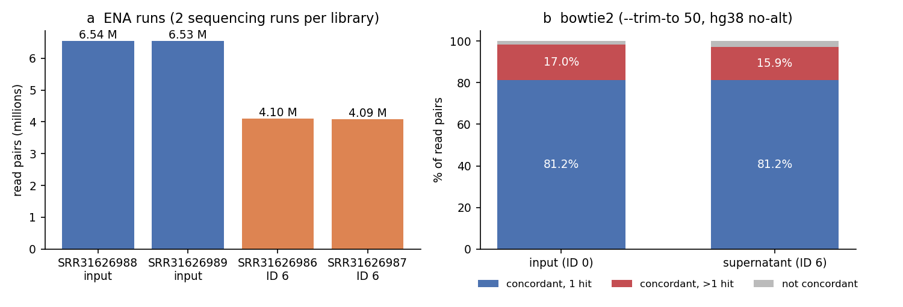
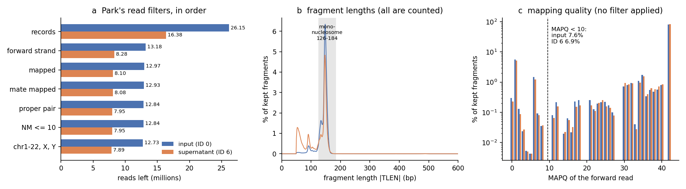
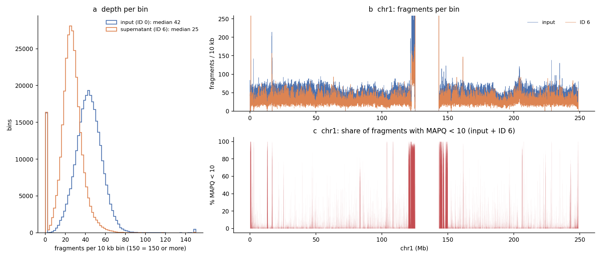
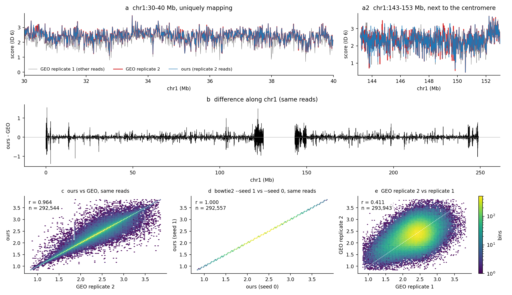
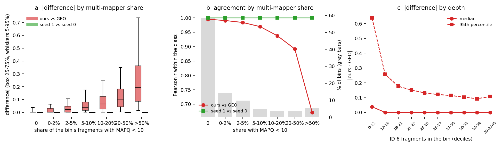
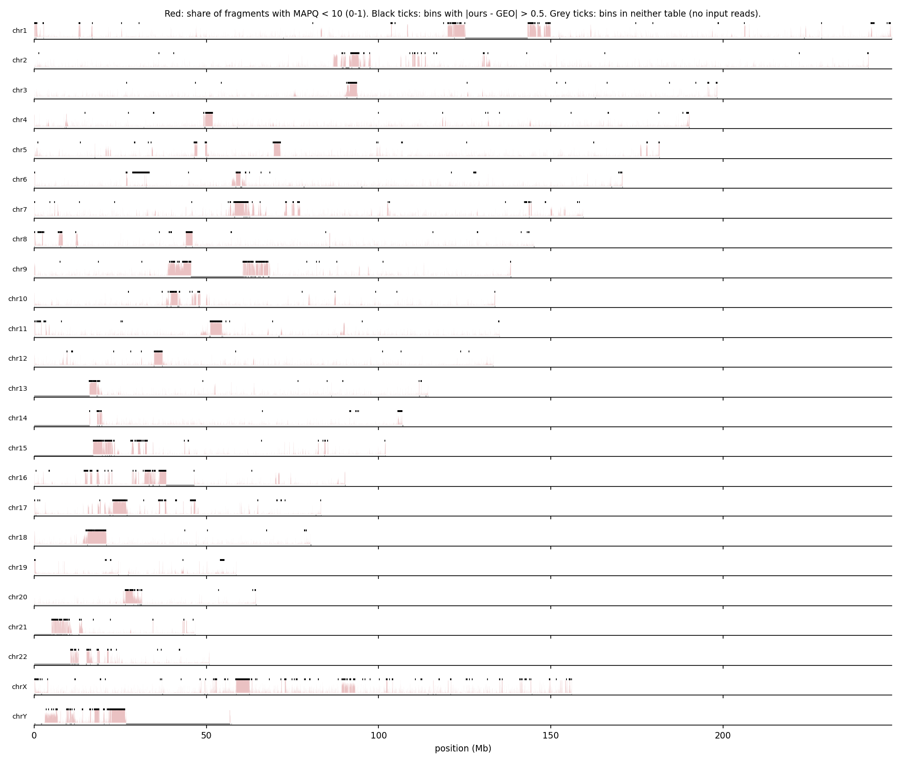
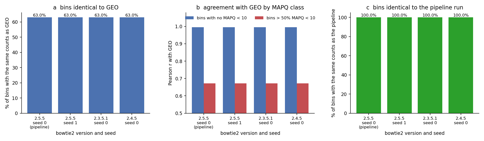
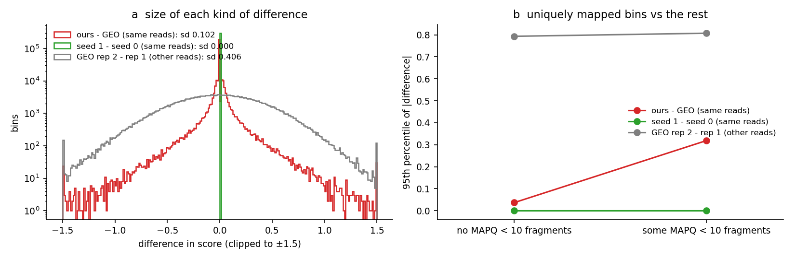

# Step 0: re-running one GEO series from raw reads (H1 NCP PEG, replicate 2, 10 kb)

**Question.** Given the raw reads behind a published GSE252941 table, does `condense-seq-pipeline`
produce that table? Where it doesn't, why not?

**Status (2026-10-13): done.** All numbers below come from `results/`; all figures are in `figures/`.

## Summary

- **No offset.** Over 292,544 bins the mean difference (ours − GEO) is −0.0003. So Park's
  titration value (f = 0.098) and our normalization match what made the GEO table.
- **63% of bins have exactly the same fragment counts as Park's.** Their scores differ only by
  one table-wide constant, −0.0005, which comes from slightly different genome-wide totals.
- **Overall r = 0.964.** In the 58% of bins with no fragment of MAPQ < 10, r = 0.995, 97% of bins
  agree within 0.05 and 87% have identical counts. The disagreement grows with the share of
  multi-mapping fragments in a bin. In bins that are more than half MAPQ < 10, r = 0.67.
  - The large differences cluster in centromeres, pericentromeric repeats, segmental duplications
    and the X/Y repeats (Fig. 06).
- **Not the aligner's version or seed.** bowtie2 2.3.5.1, 2.4.5 and 2.5.5, and seeds 0 and 1,
  give identical counts in every bin. Where a multi-mapping read lands is a fixed function of the
  read and the index.
  - The likely cause is therefore the index or reference: Park used 4DN's "4D_hg38", we use NCBI's
    prebuilt no-alt index. This could not be tested, because 4DN now requires an account key to
    download it (see "Open questions").
- **For scale:** the ours-vs-GEO differences (sd 0.10) are a quarter the size of the differences
  between Park's two biological replicates (sd 0.41, r = 0.41 at 10 kb).

## Inputs and where they come from

| Input | What | Source | Where here |
|---|---|---|---|
| Raw reads | 2 libraries × 2 sequencing runs, paired 2×~50 bp (table below) | ENA, project PRJNA1063283 (= GEO GSE252941); URLs and md5 in `../manifest.tsv` (ENA file report, 2026-10-12) | `/n/netscratch/zhuang_lab/Lab/wfli/condense-seq/raw/GSE252941/` (`../download.sbatch 0`) |
| GEO table | `GSE252941_H1_NCP_PEG_2rep_10kb_score.gtab.txt.gz` (md5 5c7a8e89…), one column `H1_NCP_PEG_6_2rep` | GEO GSE252941 supplementary files | `lab/data/GSE252941/` |
| GEO replicate 1 | `GSE252941_H1_NCP_PEG_1rep_10kb_score.gtab.txt.gz` (md5 df6b9a5e…), different reads; used only for scale | same | same |
| Titration | `H1_NCP_PEG.tsv`; ID 6 = 9.5% PEG, soluble fraction f = 0.0977444 | Park 2025 Source Data, Extended Data Fig. 8a (`SourceData_EDFig8_MOESM15.xlsx`), via `../../tools/titration_from_source_data.py` | `lab/data/park2025/titration/` |
| Reference | GRCh38 no-alt analysis set (195 sequences, UCSC names) and its prebuilt bowtie2 index | NCBI `GCA_000001405.15_GRCh38/seqs_for_alignment_pipelines.ucsc_ids/` (`../../slurm/10_reference.sbatch hg38`) | `lab/data/ref/hg38/` |
| Settings | `--trim-to 50`, bins 10 kb (and 1 kb), NM ≤ 10, no MAPQ filter, no dedup | Park's GEO driver `batch_submit_ver7.py` (see the pipeline README) | `../config_step0.yaml`, `../samples_step0.tsv` |

| Run | GSM | Library | Read pairs | FASTQ (R1 + R2) |
|---|---|---|---|---|
| SRR31626988 | GSM8667938 | input (ID 0) | 6,541,456 | 393 MB |
| SRR31626989 | GSM8667938 | input (ID 0) | 6,533,885 | 392 MB |
| SRR31626986 | GSM8667939 | supernatant, ID 6 | 4,099,961 | 247 MB |
| SRR31626987 | GSM8667939 | supernatant, ID 6 | 4,091,052 | 247 MB |

Software: bowtie2 2.5.5, samtools 1.21, Snakemake 8.30, pysam 0.22.1, numpy 2.1.3, pandas 2.2.3
(env `condseq`); figures with matplotlib 3.9.4 (env `condrepro`).

## Step by step

### 1. Download
`../download.sbatch 0` fetched the 8 FASTQ files from ENA. All md5s matched.

### 2. Align (pipeline rule `align`)
`bowtie2 --trim-to 50 -x hg38 -1 … -2 …`, end-to-end defaults, then `samtools sort` and `index`.
The two runs of a library are aligned together.



| | input (ID 0) | ID 6 |
|---|---|---|
| read pairs | 13,075,341 | 8,191,013 |
| concordant, one hit | 81.2% | 81.2% |
| concordant, more than one hit | 17.0% | 15.9% |
| overall alignment rate | 99.2% | 98.9% |

(`results/03_bowtie2.tsv`.) About one pair in six aligns equally well to more than one place.

### 3. Park's read filters (inside `bincount`)
Each fragment is counted once, from its forward-strand read, if the read and its mate are mapped
as a proper pair with edit distance ≤ 10. There is no MAPQ filter and no duplicate removal.
`scripts/01_bam_stats.py` re-applies the filters one at a time:



| Reads left after | input (ID 0) | ID 6 |
|---|---|---|
| all records | 26,150,682 | 16,382,026 |
| forward strand | 13,181,845 | 8,283,185 |
| mapped | 12,973,682 | 8,102,979 |
| mate mapped | 12,929,606 | 8,075,745 |
| proper pair | 12,839,322 | 7,954,576 |
| NM ≤ 10 | 12,839,319 | 7,954,565 |
| on chr1–22, X, Y = **fragments counted** | **12,727,441** | **7,889,186** |

- The last row equals the total of the pipeline's `bincount` table exactly, which checks script 01
  against the pipeline.
- **MAPQ (panel c):** 7.6% (input) and 6.9% (ID 6) of counted fragments have MAPQ < 10, and
  5.9% / 5.4% have MAPQ 0–1, i.e. equally good hits elsewhere. They are all counted.
- **Fragment lengths (panel b):** every length is counted.
  - Both libraries peak at 147–148 bp.
  - The ID 6 supernatant has many more short fragments: 32% under 100 bp, against 5.5% in the input.
  - 126–184 bp holds 90% of input fragments and 60% of ID 6 fragments.

### 4. Counts per 10 kb bin (`bincount --win 10000`)
A fragment goes to the bin holding its centre (even lengths: the left of the two centre bases).



- Median per bin: 42 input and 25 ID 6 fragments. At these depths, one fragment more or less
  changes a bin's score by about 0.04.
- The share of MAPQ < 10 fragments is near zero along most of chr1. It is high next to the
  centromere and in the 1q21 segmental duplications (panel c).

### 5. Score (`score`), one column (`concat`)
For each bin with input count c > 0 and ID 6 count s:

  score = −ln[(s+1)/S ÷ (c+1)/C] − ln f,  S = Σ(s+1), C = Σ(c+1) over bins with c > 0,  f = 0.0977444.

- Our totals are S = 8,181,729 and C = 13,019,998.
- A bin with s = c scores ln(S/C) − ln f = 1.8608. That value recurs in the list of most different
  bins (`results/03_top_discordant.tsv`), where a few fragments decide the score.
- Bins with c = 0 are left out, as in Park's script.

### 6. Compare with GEO



Panel a: in a uniquely mapping 10 Mb window, our track and GEO's lie on top of each other. Panel a2:
next to the centromere they separate in single bins. Panel b shows the difference along all of chr1.

| Comparison (`results/03_comparisons.tsv`) | Bins | Pearson r | Mean diff | sd diff | \|d\| < 0.05 | \|d\| > 0.5 |
|---|---|---|---|---|---|---|
| ours vs GEO, same reads | 292,544 | **0.964** | −0.0003 | 0.103 | 83.3% | 0.9% |
| ours with bowtie2 `--seed 1` vs `--seed 0` | 292,557 | 1.000 | 0 | 0 | 100% | 0% |
| GEO replicate 2 vs replicate 1 (different reads) | 293,943 | 0.411 | −0.011 | 0.406 | 10.1% | 21.1% |
| ours vs GEO replicate 1 | 292,546 | 0.411 | −0.011 | 0.404 | 10.1% | 20.9% |

**The constant shift** (`results/03_offset.tsv`):
- If a bin has the same counts in both tables, its difference is ln(S_ours/S_GEO) − ln(C_ours/C_GEO).
  That is one constant for all such bins.
- The most common difference is −0.0005, and 184,425 bins (63.0%) sit at that value (±2×10⁻⁵, the
  rounding of the printed scores). These bins have the same counts as Park's.
- So Park's genome-wide totals differ from ours by about 0.05% in the ratio of supernatant to input.

### 7. Where the differences are



| Share of the bin's fragments with MAPQ < 10 | Bins | r with GEO | median \|d\| | 95th pct \|d\| | same counts |
|---|---|---|---|---|---|
| 0 | 171,059 (58.5%) | 0.995 | 0.001 | 0.037 | 87.4% |
| 0–2% | 41,616 (14.2%) | 0.991 | 0.001 | 0.064 | 50.1% |
| 2–5% | 28,616 (9.8%) | 0.984 | 0.023 | 0.107 | 34.5% |
| 5–10% | 14,455 (4.9%) | 0.969 | 0.040 | 0.173 | 18.7% |
| 10–20% | 11,109 (3.8%) | 0.938 | 0.066 | 0.251 | 9.0% |
| 20–50% | 10,510 (3.6%) | 0.892 | 0.098 | 0.349 | 3.8% |
| > 50% | 15,179 (5.2%) | 0.672 | 0.192 | 0.736 | 1.2% |

(`results/03_by_lowmapq.tsv`; the share combines input and ID 6 fragments.)

- **Multi-mappers:** agreement falls steadily as the share of multi-mapping fragments rises.
- **Depth:** in the lowest decile (≤ 12 ID 6 fragments) the median |d| is 0.04. Every other
  decile has median 0.0005, i.e. identical counts (`results/03_by_depth.tsv`).
- **Uniquely mapped bins that still differ** (12.6% of them; `results/03_unique_residual.tsv`):
  the median |d| after the shift is 0.032, close to the 0.038 that one fragment makes. 84% are
  within 1.5× of a one-fragment change.



The bins with |d| > 0.5 (black ticks) sit where the MAPQ < 10 share is high. These are the
centromeres and pericentromeric blocks of every chromosome, 1q21, 9p/9q, the acrocentric short arms
(13–15, 21, 22), and the X centromere and X/Y repeats. chrY has the lowest agreement (r = 0.85;
`results/03_by_chrom.tsv`).

**Bins in only one table** (`results/03_row_sets.tsv`):
- 1,408 bins are only in GEO. In every one our input count is 0, so Park had at least one input
  fragment there and we had none. 280 of them are on chrY.
- 13 bins are only in ours: GEO has no row there, and we have 1–53 input fragments
  (median MAPQ < 10 share 17%).
- Both are the same multi-mapper effect at the edges of the mappable genome.

### 8. Is it the aligner? (mechanism tests)
bowtie2 picks one hit at random among equally good ones. Its manual says the generator is seeded
from the read's name, sequence and qualities and from `--seed`. If that choice explained the
differences, realigning with another seed or version should move reads in the same bins.

| Realignment of the same reads (scripts 02, 05a) | Bins with counts identical to the pipeline run |
|---|---|
| bowtie2 2.5.5, `--seed 1` | 100% |
| bowtie2 2.4.5 | 100% |
| bowtie2 2.3.5.1 | 100% |



- **Same placement every time:** all four alignments place every counted fragment in the same bin.
  A direct look at the BAMs agrees: the 3,355 MAPQ ≤ 1 reads in chr15:20–22 Mb have identical
  positions with seeds 0 and 1.
- **So the aligner isn't the cause:** with this index, a multi-mapping read always lands in the same
  place, whatever the bowtie2 version (2.3.5.1–2.5.5) or seed. Version and seed can't explain the
  differences from GEO.
- **What's left is the index.** Park's GEO driver names the reference "4D_hg38", 4DN's GRCh38
  no-alt v15 bowtie2 index (4DNFIMQPTYDY).
  - 4DN describes it as the same sequence set as ours: chr1–22, X, Y, M, the unplaced and
    unlocalized contigs and EBV.
  - But it was built separately. Which of several equal hits bowtie2 reports can depend on how
    the index was built.
- **Not tested:** 4DN refused an anonymous download (HTTP 403, 2026-10-13).
  `scripts/06a_get_4dn_index.sbatch` and `06b_align_4dn.sbatch` are ready and need a 4DN access key.

### 9. Scale



- **ours − GEO vs the replicates:** the ours − GEO differences are a narrow peak at 0 with tails
  from repeat bins (sd 0.10). The replicate 2 − replicate 1 differences are broad (sd 0.41), in
  unique and repeat bins alike.
- **Replicate agreement is low:** at this depth (~25 ID 6 fragments per bin) the two published PEG
  replicates correlate at r = 0.41.
- **What that means:** the pipeline-vs-GEO discrepancy is small next to the measurement noise of
  a single replicate. It would matter for analyses that compare the same reads processed two ways,
  not for biological conclusions.

## Conclusions

1. **The pipeline reproduces Park's processing.** Where reads map uniquely, our table matches GEO
   to the fragment in 87% of bins, and almost all of the rest are one fragment off. There is no
   offset, so the titration value, the normalization and the read filters are right.
2. **The remaining differences are about where multi-mapping fragments land.** They are
   concentrated in repeats. They are not caused by bowtie2's version or seed. The leading
   explanation is the different reference index, which hasn't been tested.
3. **Kept multi-mappers make repeat-bin scores depend on the index.** Park's settings keep all
   multi-mapping fragments (no MAPQ filter), so the scores of repeat bins depend on the index.
   Those scores (12.6% of bins have ≥ 10% MAPQ < 10 fragments) shouldn't be over-interpreted.
   `reads.min_mapq` in the pipeline removes these fragments, at the cost of no longer matching GEO.

## Open questions

- **The 4DN index test:** realign with 4DN's index (needs a 4DN access key; scripts 06a/06b).
  If the hypothesis is right, the share of bins with counts identical to GEO should rise from 63%
  toward 100%.
- **The step Park's repo doesn't show:** `bowtie-submit_ver2` is missing from the repo, so Park's
  exact alignment options are unknown.
  - The trimming option is known from the driver (`--trim-to 50`).
  - Any other option that changes alignment, e.g. `--very-sensitive`, would also change the results
    in uniquely mapped bins. The 12.6% of unique bins that differ by about one fragment could come
    from that or from the index.

## Reproduce

From `condense-seq-pipeline/` unless noted. Resource sizes are from `seff`.

```bash
sbatch slurm/10_reference.sbatch hg38                       # once; 1 core, 26 min
cd geo_test && sbatch download.sbatch 0 && cd ..            # 8 FASTQ, ~1 h
# pipeline run (Snakemake submits 11 Slurm jobs; ~30 min of compute)
module load python/3.12.11-fasrc02 && mamba activate condseq
snakemake -s workflow/Snakefile --configfile geo_test/config_step0.yaml \
  --directory /n/netscratch/zhuang_lab/Lab/wfli/condense-seq/pipeline_runs/geo_step0 --profile workflow/profiles/slurm
# analysis, from geo_test/step0/ (outside an env)
cd geo_test/step0
sbatch scripts/01_bam_stats.sbatch                          # 1 core, 0.7 GB, 2 min
sbatch scripts/02a_align_seed1.sbatch                       # 2 × 8 cores, 6-12 min
sbatch scripts/05a_bowtie2_versions.sbatch                  # 4 × 8 cores, 9-17 min (creates 2 throwaway envs)
R=/n/netscratch/zhuang_lab/Lab/wfli/condense-seq/pipeline_runs/geo_step0
for d in seed1 bt2_2.3.5.1 bt2_2.4.5; do sbatch scripts/score_10kb.sbatch $R/$d; done   # after the alignments; 3 min each
mamba activate condrepro
cd scripts && python 03_compare.py > ../results/03_compare.log && python 04_figures.py   # login node, ~1 min
```

## Files

| Path | Content |
|---|---|
| `scripts/config.py` | paths and constants for 03/04 |
| `scripts/01_bam_stats.py` (+ `.sbatch`) | read filter cascade, MAPQ and length histograms, MAPQ < 10 counts per bin |
| `scripts/02a_align_seed1.sbatch` | realign with `--seed 1` |
| `scripts/05a_bowtie2_versions.sbatch` | realign with bowtie2 2.3.5.1 and 2.4.5 |
| `scripts/06a_get_4dn_index.sbatch`, `06b_align_4dn.sbatch` | realign to 4DN's index (needs a 4DN key; not run) |
| `scripts/score_10kb.sbatch DIR` | bincount → score → table for a realignment folder |
| `scripts/03_compare.py` | all comparisons → `results/03_*` |
| `scripts/04_figures.py` | `figures/01–08` |
| `results/` | small tables (kept in git); `03_compare.log` is the console record |
| `lab/outputs/condense-seq-pipeline/geo_step0/` | the pipeline's tables (1 kb, 10 kb); `01_bins_10kb_mapq.tsv.gz`; `03_bins_joined.tsv.gz` (every per-bin value used here) |
| netscratch `pipeline_runs/geo_step0/` | BAMs and intermediates of each alignment (purged after 90 days) |
